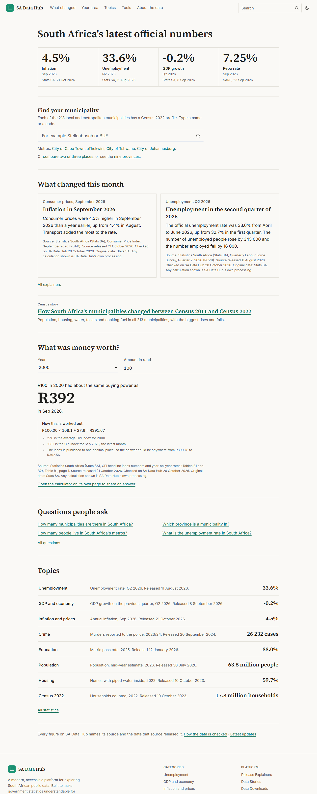
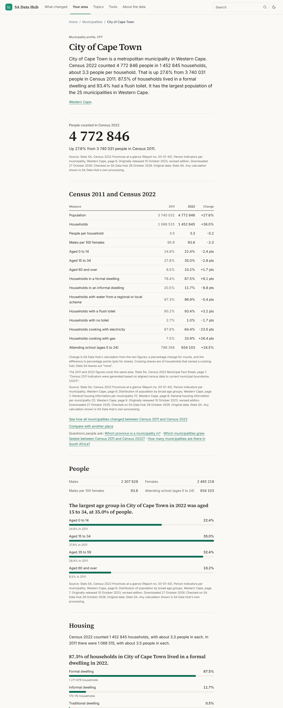
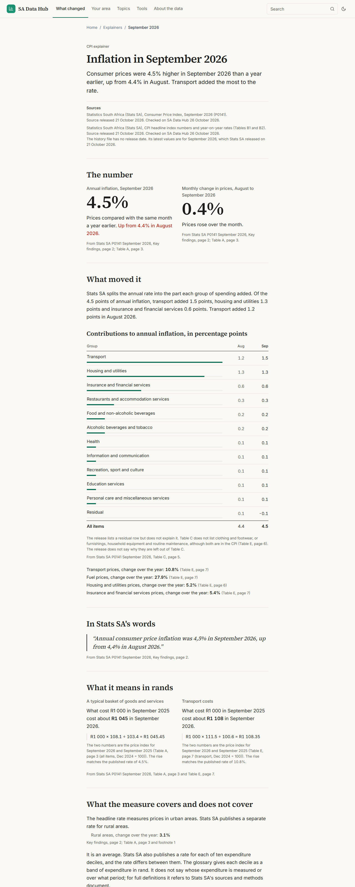

# SA Data Hub

South Africa's official numbers, explained where you live, with every figure traced to its source.

Live at [sadatahub.tech](https://sadatahub.tech). Independent and not affiliated with any government department. MIT licensed.

| Home | Municipality | Release explainer |
|------|--------------|-------------------|
|  |  |  |

## What it is

Official South African statistics are published as PDFs, Excel workbooks and portals that assume you already know where to look. SA Data Hub takes the same figures from Stats SA, the South African Reserve Bank (SARB), the South African Police Service (SAPS) and the Department of Basic Education (DBE), and puts them in plain English next to the place or release people are asking about.

Search Console for the three months to 23 October 2026 shows who uses it: 92% of clicks came from South Africa and about 80% landed on municipality pages. The product follows that. Municipality pages get the most care, and each monthly or quarterly release gets an explainer.

## What is on the site

- **213 municipality pages** built from Census 2022, with the 2011 figures on today's boundaries (Stats SA aligned them, see the census story) and a side-by-side comparison with the province and with similar places. Each page can produce a share image.
- **9 province pages** and a province explorer.
- **Release explainers** for CPI (September 2026) and the Quarterly Labour Force Survey (Q2 2026). Each gives the number, what moved it in the source's own words, a worked example in rands and what the measure leaves out.
- **Answers**: 22 short questions people ask about South African numbers, each answered in a sentence with its source.
- **Tools**: a compare tool for two or three municipalities (Census 2011 and 2022), and a money-value calculator built on Stats SA CPI history from 1980. Both make share images.
- **A census story** that walks through 2011 to 2022, plus longer data stories on unemployment, inflation, GDP, crime and matric results.
- **Topic pages** for unemployment, GDP and economy, inflation (with the repo rate), crime, education, population, housing and Census 2022, with CSV downloads and ready-made citations (APA, Harvard, Vancouver).
- **Header search** over places, statistics, answers, explainers, stories and tools, grouped, with keyboard support.
- **Guess first**: on the two explainers and two answers, readers can guess a figure before the page shows it with its source.
- **Trust pages**: methodology (with "Why do the numbers disagree?" and Stats SA's reuse condition), a public corrections log at `/updates`, a platform changelog, and an RSS feed. Datasets carry schema.org `Dataset` markup. Every page has a "Report an error" link.

## How it earns trust

Every figure shows three things: its source, the date the source released it, and the date it was last checked on SA Data Hub. The build fails if a displayed statistic is missing any of them (`assertSiteSourced()` in `src/lib/sourcing.ts`), so an unsourced number cannot ship by accident.

Other rules the project follows:

- The "why" behind a change comes from the source's own breakdown, quoted and cited. There are no forecasts and no guesses.
- Anything under "what it means" is a calculation with the working shown.
- Corrections are logged publicly with the old value, the new value and the reason.
- Data is entered by hand from releases the maintainer downloads. Nothing makes automated requests to Stats SA domains. The Python automation in `automation/` and the PostgreSQL migration in `db/` are paused.
- AI can draft text, but a person checks every number and sentence against the release before it is published.

The full set of rules is in [`docs/PRODUCT_DIRECTION.md`](docs/PRODUCT_DIRECTION.md), and what is built, paused and still missing is in [`docs/CURRENT_STATE.md`](docs/CURRENT_STATE.md). The visual system (light by default, serif headings, one accent colour, no gradients) is in [`docs/DESIGN.md`](docs/DESIGN.md). A draft write-up of the October 2026 redesign, with before and after screenshots, is in [`docs/case-study/`](docs/case-study/README.md).

## Data sources

| Source | Used for |
|--------|----------|
| Statistics South Africa | Census 2022 (Provinces at a glance, Municipal fact sheet), Quarterly Labour Force Survey, CPI, GDP, mid-year population estimates |
| South African Reserve Bank | Repo and prime rates |
| South African Police Service | Crime statistics |
| Department of Basic Education | Matric results |
| Department of Higher Education and Training | Higher education enrolment |

Definitions, release schedules and known limits are on the [methodology page](https://sadatahub.tech/methodology). Source files used for entry are kept in `sources/` (PDFs are not committed).

## Stack

Next.js 15 (App Router), TypeScript, Tailwind CSS, Recharts, Vitest, ESLint. Source Serif 4 and Inter for type. Deployed on Vercel from `main`.

Data lives in JSON files in `src/data/datasets/` and is read at build time, so almost every page is static. Setting `DATA_SOURCE=database` with a `DATABASE_URL` switches the data layer to PostgreSQL on Neon, which is paused and not used in production.

## Run it locally

```bash
git clone https://github.com/ubayd-hattas/SA_DataHub.git
cd SA_DataHub
npm install
npm run dev        # http://localhost:3000
```

No environment variables are needed for the default JSON data layer.

```bash
npm test           # Vitest
npm run lint
npm run build      # also runs the sourcing check
```

On the last full run of `main`, type-checking was clean and Vitest reported 455 passed and 27 skipped (the skipped ones need a database).

## Updating a dataset

1. Download the release from the publisher and put it in `sources/releases/`.
2. Edit the matching file in `src/data/datasets/`, keeping the source, release date and checked date for each figure.
3. Add an entry to `src/data/update-history.ts` so it appears on `/updates`.
4. Run `npm test` and `npm run build`. The sourcing check will name any figure that is missing a field.

Per-dataset steps (what to download, which files, the explainer and the 2-working-day target) are in [`docs/RUNBOOK.md`](docs/RUNBOOK.md).

## Where things are

```
src/app/            Pages: home, municipalities, provinces, category, explainers,
                    answers, insights, tools, methodology, updates, downloads
src/components/     editorial/ (shared page pieces), charts/, explainers/, home/, layout/
src/data/           datasets/*.json, answers.ts, explainers/, stories.ts, update-history.ts
src/lib/            sourcing.ts, search*.ts, compare.ts, money-value.ts, citation.ts, seo.ts
tests/              unit/ and equivalence/
docs/               Product direction, design system, case study, architecture notes
automation/, db/    Paused: scheduled data checks and the PostgreSQL migration
```

## Contributing

The most useful contribution is a correction. If a figure looks wrong, open an issue with the page, the figure and where you saw the right one, or use the "Report an error" link on any page. Suggestions for questions the Answers section should cover are also welcome. Please open an issue before a large pull request.

## Author

Built and maintained by [Ubayd Hattas](https://ubayd.me), a Computer Science, Statistics and Data Science student at the University of Cape Town. More on the [About page](https://sadatahub.tech/about).

## Licence

MIT. The underlying data remains subject to the terms of the original publishers.
