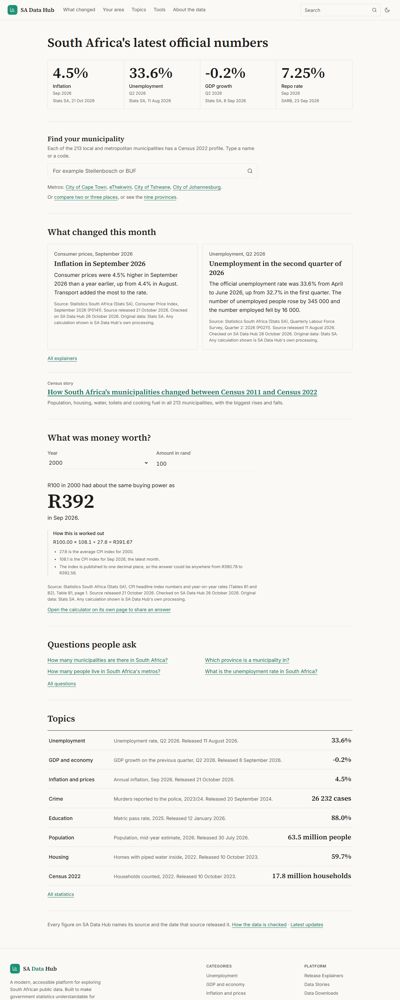
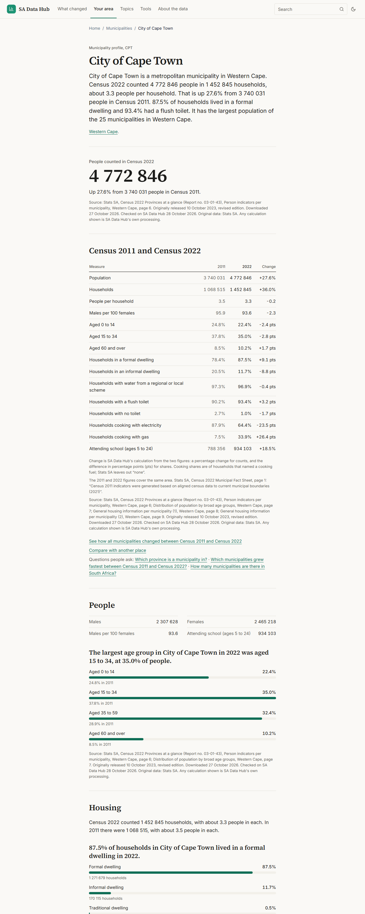
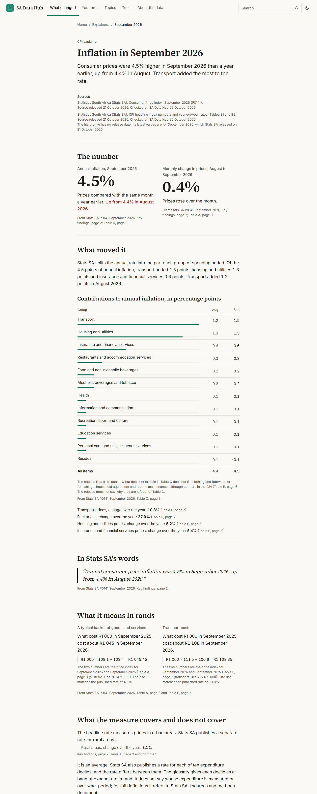

# SA Data Hub

South Africa's official numbers, explained where you live, with every figure traced to its source.

[](https://github.com/ubayd-hattas/SA_DataHub/actions/workflows/ci.yml)
[](LICENSE)

**[sadatahub.tech](https://sadatahub.tech)** · [Where it's going](#where-its-going) · [Support the project](#support-the-project) · [Contributing](#contributing)

Free, open source and independent. Not affiliated with any government department.

| Home | Municipality | Release explainer |
|------|--------------|-------------------|
|  |  |  |

## Why it exists

South Africa's official statistics come out as PDFs, Excel workbooks and portals that assume you already know where to look. SA Data Hub takes the same figures from Stats SA, the Reserve Bank, the police, the Department of Basic Education and the Electoral Commission, and puts them in plain English next to the place or release people are asking about. 92% of its search clicks come from South Africa, and most land on a municipality page.

## What is on the site

- **213 municipality pages**: Census 2011 and 2022 side by side, comparisons with similar places, and the **2026 local election results** (turnout, PR vote shares and ward wins).
- **Release explainers** for inflation and unemployment: the number, what moved it in the source's own words, and what it means in rands. A **[release calendar](https://sadatahub.tech/calendar)** (also as `.ics`) says when the next figures come out.
- **[Data series](https://sadatahub.tech/series)**: every statistic has a stable page with every value, CSV and JSON downloads, a citation, revision history and a chart other sites can embed.
- **[Why do the numbers disagree?](https://sadatahub.tech/why-numbers-differ)**: the census count against the mid-year estimate against the UN projection, and the four unemployment measures.
- **Tools and stories**: compare municipalities, see what money was worth since 1980, and data stories on unemployment, inflation, GDP, crime and matric results.
- **Trust pages**: methodology, a public corrections log, a changelog, an RSS feed and `llms.txt` for AI tools.

## How it earns trust

Every figure shows its source, the date the source released it and the date it was last checked here. The build fails if a displayed statistic is missing any of them (`assertSiteSourced()` in `src/lib/sourcing.ts`).

- Reasons for a change are quoted from the source with the page number. No forecasts and no guesses.
- Corrections are logged publicly with the old and new value.
- Data is entered by hand from releases the maintainer downloads. Nothing makes automated requests to Stats SA.
- AI can draft text, but a person checks every number and sentence against the release before it goes live.

The full rules are in [`docs/PRODUCT_DIRECTION.md`](docs/PRODUCT_DIRECTION.md).

## Where it's going

**Next, November to December 2026**

- Explainers within two working days of each release: the labour force survey (Q3), inflation (October, out 18 November), the Reserve Bank's rate decision (19 November) and GDP (Q3, December).
- Council seats and coalition arithmetic for every municipality after the 2026 local elections.
- An explainer on the Census 2022 undercount: what the Post-Enumeration Survey is, how it adjusted the count and how far to trust the figures.
- A glossary of the terms behind the numbers, and an accessibility and mobile pass for readers on small data bundles.

**After that**

- A personal inflation calculator and printable worksheets for teachers.
- Municipal spending data next to the service figures on each municipality page.
- Ward-level census figures.
- A way for AI assistants to look up and cite SA Data Hub figures directly.

What is built, paused and missing today is in [`docs/CURRENT_STATE.md`](docs/CURRENT_STATE.md).

## Support the project

SA Data Hub is built and checked by one person and will stay free. Support pays for time: explainers soon after each release, and the datasets readers ask for. Sponsors get no extra features and no say over what the site publishes.

Other ways to help, which matter as much: report an error, ask for a dataset, or share a page with someone who needs the numbers. See [sadatahub.tech/support](https://sadatahub.tech/support).

## Data sources

| Source | Used for |
|--------|----------|
| Statistics South Africa | Census 2022, labour force survey, CPI, GDP, mid-year population estimates |
| South African Reserve Bank | Repo and prime rates |
| South African Police Service | Crime statistics |
| Department of Basic Education | Matric results |
| Department of Higher Education and Training | University enrolment |
| Electoral Commission of South Africa | 2026 local government election results |
| United Nations, World Population Prospects | Population projection used for comparison |

Release files are kept locally in `sources/` and are not committed. Definitions and known limits are on the [methodology page](https://sadatahub.tech/methodology).

## Run it locally

```bash
git clone https://github.com/ubayd-hattas/SA_DataHub.git
cd SA_DataHub
npm install
npm run dev        # http://localhost:3000
```

No environment variables are needed.

```bash
npm test           # Vitest
npm run lint
npm run validate   # dataset checks (Python 3)
npm run build      # also runs the sourcing check
```

CI runs the type-check, lint, tests, dataset validation and a full build on every pull request.

**Stack:** Next.js 16 (App Router), TypeScript, Tailwind CSS, Recharts, Vitest. Data lives in JSON files in `src/data/datasets/` and is read at build time, so almost every page is static. Deployed on Vercel from `main`.

## Updating a dataset

1. Download the release from the publisher and put it in `sources/releases/`.
2. Edit the matching file in `src/data/datasets/`, keeping the source, release date and checked date for each figure. Record any revised values in the statistic's `revisions`.
3. Add an entry to `src/data/update-history.ts` so it shows on `/updates`.
4. Run `npm test` and `npm run build`.

Per-dataset steps are in [`docs/RUNBOOK.md`](docs/RUNBOOK.md).

## Where things are

```
src/app/            Pages and routes: municipalities, provinces, topics, series,
                    explainers, elections-2026, calendar, tools, methodology
src/components/     editorial/ (shared page pieces), charts/, explainers/, elections/, layout/
src/data/           datasets/*.json, explainers/, stories.ts, release-calendar.ts, update-history.ts
src/lib/            sourcing.ts, series.ts, elections.ts, schema.ts, seo.ts, citation.ts
scripts/            Repeatable data builds, e.g. scripts/elections/build_lge_2026.py
tests/              Vitest unit tests
docs/               Product direction, current state, runbook, design, case study
automation/, db/,   Paused: scheduled data checks, the PostgreSQL migration
etl/                and its ETL. Kept for reference.
```

## Contributing

The most useful contribution is a correction. Open an issue with the [error report form](https://github.com/ubayd-hattas/SA_DataHub/issues/new?template=error-report.yml) or the [data request form](https://github.com/ubayd-hattas/SA_DataHub/issues/new?template=data-request.yml), or use the "Report an error" link on any page. Please open an issue before a large pull request.

## Author

Built and maintained by [Ubayd Hattas](https://ubayd.me), a Computer Science, Statistics and Data Science student at the University of Cape Town. More on the [About page](https://sadatahub.tech/about).

## Licence

The code is MIT licensed. The figures remain subject to their publishers' terms: Stats SA, for example, asks that it is named as the original source and that any analysis is identified as the user's own.
