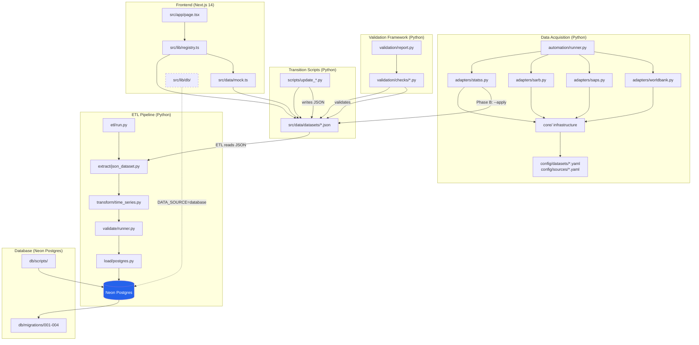

# SA Data Hub — Architecture Review

**Date:** 2026-07-29  
**Scope:** Full codebase review from source code, not from documentation  
**Purpose:** Ground-truth architecture overview, milestone roadmap, debt inventory, and documentation triage

---

## 1. Project Identity

The SA Data Hub is a public data portal for South African macroeconomic and demographic statistics. It aggregates data from Stats SA, SARB, SAPS, DBE, and the World Bank into a unified platform with automated data acquisition, ETL pipelines, a PostgreSQL backend (Neon), and a Next.js 14 frontend.

The project is a **solo-developer** data journalism platform, not a team enterprise application. This distinction matters for all architectural recommendations below.

---

## 2. Current Architecture (From Source Code)



### 2.1 Layer Inventory

| Layer | Language | Location | Status |
|-------|----------|----------|--------|
| **Automation Framework** | Python | `automation/` | Production-ready (Phase A: check. Phase B: Stats SA + SARB write paths complete) |
| **ETL Pipeline** | Python + Node.js | `etl/` | Production-ready architecture, 3 of 13 datasets wired |
| **Transition Scripts** | Python + JS | `scripts/` | Legacy — being superseded by automation |
| **Validation Framework** | Python | `validation/` | Production-ready, 10 check modules |
| **Database** | SQL | `db/` | Schema complete, migrations 001-004 ready, seed data comprehensive |
| **Frontend** | TypeScript/React | `src/` | Mature, feature-rich, currently JSON-driven |
| **Probe Scripts** | Python | Root `*.py` | One-off research artifacts, not maintained |

---

## 3. Layer-by-Layer Assessment

### 3.1 Automation Framework (`automation/`)

**Architecture:** Plugin-based adapter system with auto-discovery, YAML-driven configuration, structured reporting.

**What's built:**
- `BaseAdapter` ABC with 4-method contract: `validate_config()`, `check_for_updates()`, `run()`, `describe()`
- 4 adapters registered: Stats SA (257KB — the largest, implements QLFS Excel parsing), SARB (44KB — MPC scraping + interest rate extraction), SAPS (7KB — crime stats), World Bank (7KB — API consumer)
- 13 dataset YAML configs covering all JSON datasets
- 4 source YAML configs (statssa, sarb, saps, worldbank)
- Core infrastructure: HTTP client with retry/backoff, structured logging, metadata management, staging→approval→promote pipeline, version tracking, Markdown + JSON reporting
- Runner with CLI: `--list`, `--adapter <id>`, `--dry-run`, `--json`, `--apply`, `--approve`, `--promote`

**What works:**
- Phase A (detection/monitoring) is fully operational for all 4 adapters
- Phase B (fetch→download→archive→parse→transform→validate→stage→promote) works end-to-end for SARB interest rates and Stats SA QLFS family (unemployment, youth-unemployment, labour-force)

**What's incomplete:**
- Phase B write paths not yet built for: GDP, CPI, population, housing, crime, education, census, provinces, municipalities
- Implementation specs exist for GDP, CPI, Population (in `docs/`) but are **not yet implemented in code**

**Maturity:** β+ (production-quality architecture, partial dataset coverage)

---

### 3.2 ETL Pipeline (`etl/`)

**Architecture:** Strict 5-stage pipeline: Extract → Transform → Validate → Preview → Load.

**What's built:**
- Extract: JSON dataset reader with immutable raw snapshot archival (`.meta.json` sidecars)
- Transform: Time-series normalizer with robust period label parsing (quarters, months, fiscal years)
- Validate: JSON schema + data sanity checks + subprocess integration with `validation/report.py`
- Load: Idempotent PostgreSQL upserts via `psycopg` with `ON CONFLICT` + change detection + audit logging
- Verify: Node.js verification tool comparing DB state against source JSON baselines
- Preview mode (default): safe dry-run that shows what would be loaded

**Registered pipelines:**
| Pipeline | Status | Registration |
|----------|--------|--------------|
| `unemployment` | ✅ Complete | ✅ Registered in `run.py` |
| `youth-unemployment` | ✅ Complete | ✅ Registered in `run.py` |
| `interest-rates` | ✅ Complete | ❌ **NOT registered** in `run.py` or `verify.mjs` |

> [!WARNING]
> `etl/pipelines/interest_rates.py` is fully implemented but **cannot be invoked** because it is missing from the `PIPELINES` dict in `run.py` and `PIPELINE_CONFIG` in `verify.mjs`. This is a wiring bug, not a missing feature.

**Maturity:** Production-ready architecture, but only 2 of 13 datasets are actually wired. The interest-rates pipeline exists but is disconnected.

---

### 3.3 Frontend (`src/`)

**Architecture:** Next.js 14 App Router, Tailwind CSS, Recharts, Lucide icons, Vercel Analytics.

**Complete pages (not stubs):**

| Route | Purpose | Status |
|-------|---------|--------|
| `/` | Home — hero, key indicators, category grid | ✅ Complete |
| `/dashboard` | Interactive search + data explorer | ✅ Complete |
| `/category/[slug]` | Category detail with stats + charts | ✅ Complete |
| `/insights` + `/insights/[slug]` | Data storytelling articles | ✅ Complete |
| `/municipalities` + `/municipalities/[code]` | 213 municipality profiles | ✅ Complete |
| `/provinces` + `/provinces/[id]` | 9 provincial profiles | ✅ Complete |
| `/downloads` | CSV export download center | ✅ Complete |
| `/methodology` | Data sources + definitions | ✅ Complete |
| `/updates` | Dataset freshness + update log | ✅ Complete |
| `/changelog` | Platform version history | ✅ Complete |
| `/about` | Project information | ✅ Complete |

**Component inventory:**
- Charts: `AgeStructureChart`, `BarChartCard`, `BasicServicesChart`, `HousingCompositionChart`, `LineChartCard`
- UI: `CategoryCard`, `CitationWidget` (APA/Harvard), `DatasetExplanation`, `ExportButton`, `FreshnessIndicator`, `HistoricalTimeline`, `InsightPanel`, `ProvinceCard`, `SearchBar`, `SourceBadge`, `StatCallout`, `StatCard`, `StoryCard`
- Layout: `Navbar`, `Footer`, `ThemeProvider` (dark mode)
- SEO: `Breadcrumbs`, `JsonLd` (structured data)

**Key library modules:**
- `registry.ts` — Single source of truth for 12 dataset entries. All downstream features (exports, citations, freshness, updates) read from here.
- `search.ts` + `search-intent.ts` — Intent-aware fuzzy search with synonym dictionary
- `insights.ts` — Algorithmic insight generation from time-series data (trends, turning points, momentum)
- `explanations.ts` — Structured context blocks (What changed, Long-term trend, Why it matters)
- `export.ts` — Client-side CSV generation (series + summary modes)
- `citation.ts` — APA/Harvard citation generators
- `schema.ts` — JSON-LD structured data (Website, Organization, Dataset, Article, AdministrativeArea)
- `municipality-copy.ts` — Programmatic intro paragraph generation for 213 municipalities

**SEO:** Comprehensive — dynamic `sitemap.ts`, `robots.ts`, `manifest.ts`, dynamic OG images via `next/og`, per-page metadata via `buildPageMetadata()`.

**Data source toggle:** `src/lib/data-source.ts` implements a `json` / `database` mode switch via `DATA_SOURCE` env var. Currently running in `json` mode. The `src/lib/db/` layer has complete query functions for `statistics`, `datasets`, `geographies`, and `observations` — ready for activation.

**API routes:** Only `api/test-db/route.ts` (database health check). No public API endpoints yet.

**Maturity:** Production-quality. The frontend is the most mature layer. All pages are fully implemented, not stubs.

---

### 3.4 Database (`db/`)

**Schema:** 12 tables in a star-schema/fact-dimension model:

| Table | Type | Purpose |
|-------|------|---------|
| `schema_migrations` | System | Migration tracking |
| `data_sources` | Dimension | Stats SA, SARB, SAPS, DBE, World Bank |
| `categories` | Dimension | UI category pages |
| `geographies` | Dimension | National → Province → Municipality hierarchy (self-referencing) |
| `datasets` | Dimension | One row per `stat_id` with full-text search vector |
| `dataset_versions` | Audit | ETL run log |
| `observations` | **Fact** | Central time-series table (dataset × geography × period) |
| `statistic_snapshots` | Materialised | Headline values derived from latest observations |
| `municipality_profiles` | Profile | Census 2022 wide profiles (JSONB) |
| `province_snapshots` | Profile | Composite province blobs (JSONB) |
| `update_events` | Audit | Human-readable dataset update history |
| `stories` + `story_sections` | Content | Authored data stories |
| `platform_changelog` | Content | App version history |

**Migration system:** 4 sequential SQL migrations with `db/migrate.mjs` runner. Supports `--status` check.

**Seed data:** `004_seed_reference_data.sql` (40KB) — comprehensive seeding of sources, categories, geographies (national + 9 provinces + 213 municipalities), and all 28+ dataset entries.

**Tooling:** `generate_seed.mjs` (generates seed SQL from JSON), `inspect.mjs` (schema inspector), `reset_dev.mjs` (dev reset).

**Maturity:** Schema is complete and well-designed. The migration system works. The schema has not been battle-tested with production data at scale because the frontend still runs on JSON.

---

### 3.5 Transition Scripts (`scripts/`)

**What they are:** 13 Python scripts that update `src/data/datasets/*.json` files by fetching data from source APIs. These are the **Gen 1** data pipeline — they predate the automation framework.

| Script | Dataset | Overlap with automation? |
|--------|---------|--------------------------|
| `update_unemployment.py` | unemployment.json | ✅ Superseded by `automation/adapters/statss.py` |
| `update_interest_rates.py` | interest-rates.json | ✅ Superseded by `automation/adapters/sarb.py` |
| `update_sarb_rates.py` | interest-rates.json | ✅ Superseded (alternate approach) |
| `update_inflation.py` | inflation.json | ⚠️ Not yet superseded |
| `update_gdp.py` | gdp.json | ⚠️ Not yet superseded |
| `update_population.py` | population.json | ⚠️ Not yet superseded |
| `update_crime.py` | crime.json | ⚠️ Not yet superseded |
| `update_education.py` | education.json | ⚠️ Not yet superseded |
| `update_housing.py` | housing.json | ⚠️ Not yet superseded |
| `update_census.py` | census.json | ⚠️ Not yet superseded |
| `update_all.py` | Orchestrator | Runs all of the above |
| `transform_municipalities.js` | municipalities.json | Static transform |

**Relationship:** `scripts/` writes JSON → `etl/` reads JSON → loads to Postgres. The automation framework aims to **replace** `scripts/` entirely, but only 2 datasets have been migrated so far.

---

### 3.6 Validation Framework (`validation/`)

**Architecture:** 10 independent check modules, each implementing a consistent interface, orchestrated by `report.py`:

- `check_json_structure.py` — Top-level JSON shape
- `check_schema.py` — Schema conformance
- `check_missing_fields.py` — Required field presence
- `check_duplicate_ids.py` — Unique stat IDs
- `check_duplicate_slugs.py` — Unique slugs
- `check_dates.py` — Date format/range validation
- `check_relationships.py` — Foreign key integrity
- `check_geography_integrity.py` — Geography hierarchy
- `check_dataset_consistency.py` — Cross-dataset consistency
- `check_registry_integrity.py` — Registry↔JSON alignment

**Maturity:** Production-quality. Clean design, good coverage. Invokable via `npm run validate`.

---

### 3.7 Root Probe Scripts

14 Python scripts (`cpi_probe.py`, `excel_probe.py`, `hub_probe.py`, etc.) in the project root. These are **research/debugging artifacts** — one-off scripts used to probe Stats SA's website structure, Excel file formats, and HTTP endpoints during the discovery phase of building adapters.

> [!IMPORTANT]
> These are not maintained code. They should be archived or deleted (see §7).

---

### 3.8 Filesystem Anomalies

- **`{src/` directory** — A directory literally named `{src` containing `{app/{dashboard,category},components/{ui,charts,layout},lib,data,types},public}`. This is a brace-expansion accident from a shell command. It's empty and should be deleted.
- **`automation.zip`** (461KB) — Snapshot of the automation framework. Should not be in version control.
- **`repomix-output.xml`** (649KB) — Tool output, already gitignored but present on disk.
- **`hub_debug.html`** and **`pub_dir.html`** — Debug/probe artifacts in root.

---

## 4. Roadmap — Major Milestones

### Phase 1 — Automation Framework ✅ COMPLETE

**Status:** The core framework, plugin system, runner, and infrastructure are done. Stats SA and SARB Phase B write paths are operational.

**What "complete" means here:** The architecture, adapter contract, core infrastructure (retry, HTTP, logging, metadata, staging, promote, version tracking, reporting), and CLI are stable and should not be refactored. New datasets are added by writing adapters + YAML config, not by modifying the framework.

> [!TIP]
> **DO NOT TOUCH:** `automation/core/`, `automation/adapters/base.py`, `automation/adapters/__init__.py`, `automation/runner.py`. These are stable infrastructure. Changes here have high blast radius.

---

### Phase 2 — Data Ingestion (Remaining Datasets)

**Why:** 10 of 13 datasets still use `scripts/update_*.py` (Gen 1 pipeline). They need automation framework adapters (Gen 2) so the entire portfolio is on one pipeline.

**What's needed:**
- Stats SA adapter extensions: GDP write path, CPI write path, Population write path (with source guard)
- SAPS adapter: Crime write path
- World Bank / DBE: Education, housing adapters
- Census: Static dataset, low priority
- Municipality/Province: Aggregation pipelines

**Dependencies:** Phase 1 (done)

**Effort:**
| Dataset | Spec exists? | Adapter exists? | Estimated effort |
|---------|-------------|-----------------|------------------|
| GDP | ✅ `IMPLEMENTATION-SPEC-GDP.md` | ⚠️ Parser not built | Medium (2-3 days) |
| CPI | ✅ `IMPLEMENTATION-SPEC-CPI.md` | ⚠️ Parser not built | Medium (2-3 days) |
| Population | ✅ `IMPLEMENTATION-SPEC-POPULATION.md` | ⚠️ Parser not built + source guard | Medium-High (3-4 days) |
| Crime | ❌ No spec | ⚠️ SAPS adapter is stub-like | Medium (2-3 days) |
| Education | ❌ No spec | ❌ Not started | Medium (2-3 days) |
| Housing | ❌ No spec | ❌ Not started | Medium (2-3 days) |
| Census | ❌ No spec | ❌ Static data, low urgency | Low (1 day) |
| Provinces | ❌ No spec | ❌ Aggregation pipeline | Low-Medium (1-2 days) |
| Municipalities | ❌ No spec | ❌ Static, already in JSON | Low (1 day) |

**Risk:** Medium. Stats SA's Excel workbook layouts are unpredictable and unversioned — each new dataset requires empirical discovery against real workbooks. The spec for Population explicitly flags a data integrity bug (World Bank source vs. Stats SA source).

**Recommendation:** Prioritise GDP and CPI (they have complete implementation specs), then crime (SAPS has a different website structure), then education/housing.

---

### Phase 3 — Database Migration (JSON → Postgres)

**Why:** The frontend currently reads 13 JSON files. The database schema, migration system, seed data, and frontend query layer (`src/lib/db/`) are all built but **not activated**. Switching from JSON to Postgres unlocks scalability, full-text search, and proper time-series queries.

**What's needed:**
1. Wire the `interest-rates` ETL pipeline (fix registration bug)
2. Create ETL pipelines for remaining 10 datasets (GDP, CPI, inflation, crime, education, housing, census, population, provinces, municipalities)
3. Run all pipelines to populate the database
4. Flip `DATA_SOURCE=database` in production
5. Update `src/data/providers/` to use the database provider path
6. Verify all pages render correctly from DB data
7. Retire JSON-mode code path (or keep as fallback)

**Dependencies:** Phase 2 (at least the high-priority datasets need working automation before you can keep the DB current). ETL pipeline infrastructure is ready.

**Effort:** Large (2-3 weeks). The schema and query layer are done. The work is in creating 10+ ETL pipeline modules following the existing pattern.

**Risk:** Medium. The ETL framework is proven (unemployment + youth-unemployment work end-to-end), so this is pattern replication. Risk comes from edge cases in data formats and the need to validate every dataset's DB representation matches its JSON representation exactly (equivalence testing already has a framework in `tests/equivalence/`).

---

### Phase 4 — API Layer

**Why:** Currently there are no public API endpoints. The only API route is a DB health check. A REST/JSON API would let external consumers access SA Data Hub data programmatically.

**What's needed:**
1. Design API routes: `/api/datasets`, `/api/datasets/[slug]`, `/api/statistics/[statId]`, `/api/observations`, `/api/geographies`
2. Implement query functions (mostly done in `src/lib/db/`)
3. Add rate limiting, caching headers, CORS
4. API documentation (OpenAPI spec)

**Dependencies:** Phase 3 (database must be the live data source)

**Effort:** Medium (1-2 weeks). The query layer in `src/lib/db/` already has the core functions. API design doc exists at `docs/api-design.md` (though it may need updating).

**Risk:** Low. This is standard Next.js API route work with existing query functions.

---

### Phase 5 — UI/UX Polish

**Why:** The frontend is feature-complete but could benefit from performance optimisation and accessibility hardening.

**What's needed:**
1. Performance: Implement ISR/SSG for static pages, optimize bundle size
2. Accessibility audit (WCAG 2.1 AA)
3. Mobile-specific optimisations
4. Error boundaries and loading states for DB-backed pages
5. Stale data indicators when DB connection fails (graceful degradation)

**Dependencies:** Phase 3 (DB mode needs proper error handling in UI)

**Effort:** Low-Medium (1 week). The design system is mature. This is polish, not redesign.

**Risk:** Low.

---

### Phase 6 — Storytelling & Insights

**Why:** The insights engine (`src/lib/insights.ts`) and story system (`src/data/stories.ts`) are functional but content-limited.

**What's needed:**
1. Write more data stories (currently ~6 stories)
2. Enhance algorithmic insights with cross-dataset correlations
3. Move stories to database (schema already exists: `stories` + `story_sections` tables)
4. Add editorial workflow for new stories

**Dependencies:** Phase 3 (for DB-backed stories), but new stories can be added to `stories.ts` now

**Effort:** Medium (ongoing content work, 1 week for DB migration of stories)

**Risk:** Low. The infrastructure is built.

---

### Phase 7 — SEO & Discoverability

**Why:** SEO infrastructure is already excellent (sitemap, robots, JSON-LD, OG images, structured data). This phase is about maintaining and extending it.

**What's already done:**
- ✅ Dynamic sitemap with priority scoring
- ✅ robots.ts
- ✅ JSON-LD for Website, Organization, Dataset, Article, AdministrativeArea
- ✅ Dynamic OG images
- ✅ PWA manifest
- ✅ Google Search Console verification (`google1e1a0b335f98cead.html`)
- ✅ Intent-aware search with fuzzy matching
- ✅ `buildPageMetadata()` standardised across all pages

**What's remaining:**
1. Submit sitemap to Google Search Console and monitor indexing
2. Add FAQ schema for methodology pages
3. Monitor Core Web Vitals after DB migration
4. Consider adding `BreadcrumbList` schema to more pages

**Dependencies:** None — can be done anytime

**Effort:** Low (2-3 days)

**Risk:** Low.

---

### Phase 8 — Monitoring & Operations

**Why:** The automation framework produces reports but there is no alerting or scheduling.

**What's needed:**
1. Scheduled automation runs (cron / GitHub Actions / Vercel Cron)
2. Alert on adapter failures (email / webhook / Slack)
3. Database monitoring (connection pool health, query performance)
4. Data freshness monitoring (automated checks against expected update frequencies from YAML configs)
5. Error budget tracking

**Dependencies:** Phase 2 (all adapters should be working), Phase 3 (database live)

**Effort:** Medium (1-2 weeks)

**Risk:** Low-Medium. The framework's reporting system is solid but needs an alerting layer.

---

## 5. Technical & Architectural Debt

### 5.1 Technical Debt

| Issue | Severity | Location | Notes |
|-------|----------|----------|-------|
| **Interest-rates ETL pipeline not registered** | 🔴 High | `etl/run.py`, `etl/verify.mjs` | Fully implemented pipeline cannot be invoked |
| **14 probe scripts in project root** | 🟡 Medium | `*.py` in root | Research artifacts polluting the root directory |
| **`{src/` garbage directory** | 🟡 Medium | Project root | Brace-expansion accident, empty, should be deleted |
| **`automation.zip` in repo** | 🟡 Medium | Project root | Binary blob in version control |
| **`repomix-output.xml` on disk** | 🟢 Low | Project root | Already gitignored but present |
| **`hub_debug.html` + `pub_dir.html`** | 🟢 Low | Project root | Debug artifacts |
| **`__pycache__/` directories tracked** | 🟢 Low | Multiple | Should be gitignored |
| **`.env.local` present** | 🟢 Low | Project root | Contains secrets, should not be on disk in shared repos |
| **Hardcoded ETL notes** | 🟢 Low | `etl/pipelines/unemployment.py` | `"ETL load in progress"` instead of dynamic notes |

### 5.2 Architectural Debt

| Issue | Severity | Notes |
|-------|----------|-------|
| **Three parallel data pipelines** | 🔴 High | `scripts/` (Gen 1), `automation/` (Gen 2), `etl/` (Gen 3 loader). The target is: automation fetches → writes JSON → ETL loads JSON → DB. `scripts/` should be retired once automation covers all datasets. |
| **Dual data source paths** | 🟡 Medium | Frontend maintains both JSON and DB code paths. This is intentional for the transition but adds maintenance burden. After DB migration, the JSON path should become a test-only fallback. |
| **No caching layer** | 🟡 Medium | No Redis, no ISR, no CDN caching strategy for API responses or pages. Not a problem today (JSON is fast), but will matter after DB migration. |

### 5.3 Over-Engineered Components

| Component | Assessment |
|-----------|------------|
| **Automation framework** | Appropriately engineered for its purpose. The plugin system, YAML config, and reporting are justified by the complexity of scraping 4 different data sources with different release schedules. |
| **SEO infrastructure** | Thorough but not over-engineered. For a public data portal, comprehensive SEO is table stakes. |
| **Validation framework** | 10 check modules may seem excessive for 13 JSON files, but they catch real bugs during data updates. Keep. |

**Verdict:** Nothing is significantly over-engineered. The project is well-calibrated for its scope.

### 5.4 Under-Engineered Components

| Component | Assessment |
|-----------|------------|
| **Test coverage** | Unit tests exist for period parsing and equivalence checks, but no integration tests for automation adapters, ETL pipelines, or API routes. The `tests/` directory has structure but thin content. |
| **Error handling in DB mode** | The frontend's DB path has basic error handling but no retry logic, circuit breakers, or graceful degradation to JSON on DB failure. |
| **CI/CD pipeline** | No evidence of GitHub Actions, deployment scripts, or automated testing in CI. |

### 5.5 Areas That Should NOT Be Touched

| Component | Reason |
|-----------|--------|
| `automation/core/*` | Stable infrastructure. Proven in production. Changes here cascade through all adapters. |
| `automation/adapters/base.py` | The adapter contract is settled. 4 adapters conform to it. |
| `automation/adapters/__init__.py` | Plugin discovery system works. |
| `automation/runner.py` | Orchestrator is feature-complete with CLI, reporting, and exit codes. |
| `src/lib/registry.ts` | Central metadata registry. All downstream features depend on its shape. |
| `src/lib/schema.ts` | JSON-LD structured data. Validated and correct. |
| `validation/` | Working quality gate. Already integrated into ETL. |
| `db/migrations/001-004` | Applied schema. Don't modify applied migrations — add new ones. |

---

## 6. Documentation Triage

### 6.1 Documents to KEEP (Permanent Documentation)

| File | Reason |
|------|--------|
| `README.md` (root) | Project entry point. Needs periodic refresh but is permanent. |
| `docs/architecture.md` | Core architecture reference. Should be updated to reflect this review. |
| `docs/api-design.md` | API design spec — still needed for Phase 4. |
| `docs/database-schema.md` | Schema reference — cross-check against migrations. |
| `docs/development-guide.md` | Onboarding doc. Keep current. |
| `docs/etl-pipeline.md` | ETL architecture reference. Accurate. |
| `docs/dataset-analysis.md` | Dataset rules and constraints. Reference material. |
| `docs/testing-strategy.md` | Testing approach. Keep. |
| `automation/docs/developer-guide.md` | Automation contributor guide. Keep. |
| `db/README.md` | Database setup guide. Keep. |
| `etl/README.md` | ETL usage guide. Keep. |
| `validation/README.md` | Validation framework guide. Keep. |

### 6.2 Documents to REWRITE (Stale But Relevant)

| File | Issue |
|------|-------|
| `docs/implementation-status.md` | Outdated status tracker — doesn't reflect current state. Rewrite or replace with this review. |
| `docs/future-roadmap.md` | Original roadmap — largely superseded by actual implementation. Rewrite to match §4 above. |
| `docs/migration-plan.md` | DB migration plan — still relevant but details may have drifted from actual schema. |
| `docs/migration-readiness.md` | Readiness assessment — needs updating post-schema completion. |
| `docs/ai-context.md` | AI assistant context — useful but likely outdated. |
| `docs/CURRENT_STATE.md` | Large state document — replace with a shorter, current version. |

### 6.3 Documents to ARCHIVE (Historical — Move to `docs/archive/`)

| File | Reason |
|------|--------|
| `docs/CHANGELOG.md` (78KB) | Historical log. Valuable for archaeology but not daily reference. |
| `docs/SA-Data-Hub-Automation-Architecture.md` | Original architecture vision — now superseded by the implemented code. |
| `docs/SA-Data-Hub-Dataset-Sourcing-Plan.md` | Original sourcing plan — most decisions are now implemented. |
| `docs/automation_r1.md` | Round 1 automation spec — historical. |
| `docs/IMPLEMENTATION-SPEC-2026-07-12.md` | Completed implementation spec (QLFS Phase 1). Archive. |
| `docs/IMPLEMENTATION-SPEC-STATSSA-PHASE2.md` | Completed implementation spec (QLFS Phase 2). Archive. |
| `docs/IMPLEMENTATION-SPEC-STATSSA-WAF.md` | Completed spec (WAF handling). Archive. |
| `docs/Implementation Spec Stats SA WAFExc.md` | WAF exception handling spec. Archive. |
| `docs/ARCHITECTURE-REVIEW-SOURCE-ACQUISITION-2026-07-21.md` | Completed architecture review. Archive. |
| `docs/ARCHITECTURE-REVIEW-WORKBOOK-DISCOVERY-2026-07-21.md` | Completed architecture review. Archive. |
| `docs/standardisation-changelog.md` | Historical standardisation log. Archive. |

### 6.4 Documents to KEEP BUT FLAG (Active Specs — Not Yet Implemented)

| File | Status |
|------|--------|
| `docs/IMPLEMENTATION-SPEC-GDP.md` | **Not yet built.** Keep until GDP adapter is implemented, then archive. |
| `docs/IMPLEMENTATION-SPEC-CPI.md` | **Not yet built.** Keep until CPI adapter is implemented, then archive. |
| `docs/IMPLEMENTATION-SPEC-POPULATION.md` | **Not yet built.** Keep until population adapter is implemented, then archive. |

### 6.5 Files to DELETE (No Remaining Value)

| File | Reason |
|------|--------|
| Root probe scripts (14 files) | Research artifacts. If any contain valuable logic, extract it first. |
| `{src/` directory | Garbage from brace expansion. |
| `automation.zip` | Binary snapshot. No place in VCS. |
| `hub_debug.html`, `pub_dir.html` | Debug artifacts. |
| `repomix-output.xml` | Tool output (already gitignored). |
| `test-data/` (empty) | Empty directory. |

---

## 7. Summary

### What's Working Well
- **Automation framework architecture** — clean, extensible, well-documented
- **Frontend** — feature-rich, all pages implemented, excellent SEO
- **Database schema** — well-designed star schema with comprehensive seed data
- **ETL pipeline architecture** — safe-by-default, idempotent, auditable
- **Validation framework** — 10 independent checks, good coverage
- **Dataset registry** — single source of truth driving all downstream features

### What Needs Attention
1. **Fix the interest-rates ETL wiring bug** — immediate, 5 minutes
2. **Clean up root directory** — delete probe scripts, `{src/`, zip, debug HTML
3. **Complete Phase 2 (remaining dataset adapters)** — the main remaining engineering work
4. **Activate database mode** — the infrastructure is ready, the data isn't loaded yet
5. **Add CI/CD** — no automated testing or deployment pipeline exists
6. **Archive stale documentation** — 11 documents should move to `docs/archive/`

### The Critical Path

```
Fix interest-rates wiring → Build remaining adapters (GDP, CPI first)
→ Create remaining ETL pipelines → Load all data to Postgres
→ Flip DATA_SOURCE=database → Add API routes → Ship
```

The project's architecture is sound. The remaining work is **breadth** (more datasets), not **depth** (new systems). No architectural redesign is needed.
