# SA Data Hub: case study (draft)

SA Data Hub ([sadatahub.tech](https://sadatahub.tech)) publishes South Africa's official statistics with a source and two dates on every figure. This is a draft write-up of how it changed in October 2026.

## What the site was

The site collected figures from Stats SA, the South African Reserve Bank (SARB), the South African Police Service (SAPS) and the Department of Basic Education into topic pages, a dashboard, province pages and 213 municipality profiles built from Census 2022.

It worked, but it read like a dashboard template: dark cards, coloured badges, gradients and charts with generic titles. Several figures could not be traced to a published table. Some text gave reasons for changes that the sources never gave. Maintainer notes were shipped to the browser with the data.

Search Console, the three months to 23 October 2026:

- 482 clicks and 36 600 impressions.
- 92% of clicks came from South Africa.
- Municipality pages brought about 80% of clicks.
- Indexed pages fell from 232 in mid-August to 89 by 23 October.

So the people arriving were mostly South Africans looking up a place, and the site was losing its place in the index.

## What changed

The work followed the product direction in `docs/PRODUCT_DIRECTION.md`, in pull requests #2 to #30.

**Release explainers.** One page per official release: the number, what moved it in the source's own words, a worked calculation and what the measure does not cover. CPI for September 2026 came first, then unemployment for the second quarter of 2026, with a section on why South Africa publishes more than one unemployment rate.

**Municipality pages.** Every 2011 and 2022 figure on all 213 profiles was checked against Stats SA's Census 2022 Provinces at a glance with a script that only accepts a table row when the table's own totals add up. 209 municipalities matched exactly. Four were corrected, two of them to Stats SA's published erratum. Each figure now cites the table and the printed page it comes from. A story page compares Census 2011 and Census 2022 across all 213.

**Design.** A small design system (`docs/DESIGN.md`): light by default, one accent colour, one colour each for a good and a bad change, serif headings, whitespace instead of cards, and chart titles that state the finding. Colour is never the only signal.

**Trust layer.** A build step fails if a figure on the homepage, a topic page or a municipality page has no source, no release date or no checked date. The same check already covered the explainers. Figures that could not be traced were withheld rather than shown without a date, and each withholding is recorded. The corrections log at `/updates` lists old and new values.

**Discoverability.** Unique titles and descriptions on every page, schema.org Dataset data that points to a CSV file per dataset, and an RSS feed of explainers, stories and updates.

**Performance and accessibility.** The dashboard stopped loading every dataset in the browser (324 kB to 239 kB of JavaScript on first load), and the provinces page became server-rendered (307 kB to 107 kB). After the footer's contrast was fixed, an automated accessibility check (axe) found no serious issues on the homepage, a topic page, the CPI explainer and the calculator, and keyboard focus was visible at every stop on six pages. The rebuilt municipality page has not been checked yet.

## Principles

1. **Every figure is sourced.** It names the publication, the table and page, the date the source released it and the date SA Data Hub checked it.
2. **No speculation.** A reason for a change appears only when the source gives it, quoted with its page. Otherwise the site says what changed and stops.
3. **The build checks the sourcing.** If a figure loses its source or a date, the site does not build.
4. **Corrections are public.** Each one is logged with the old and new value.
5. **Data is entered by hand from downloaded releases.** No automated requests to Stats SA.

## Before and after

Before: the site at pull request #14, when the CPI explainer already existed but the rest of the site still had the old design, dark by default. After: the work in pull requests #23 and #24, light by default. Same pages, same widths.

| Page | Before | After |
| --- | --- | --- |
| Homepage, desktop | 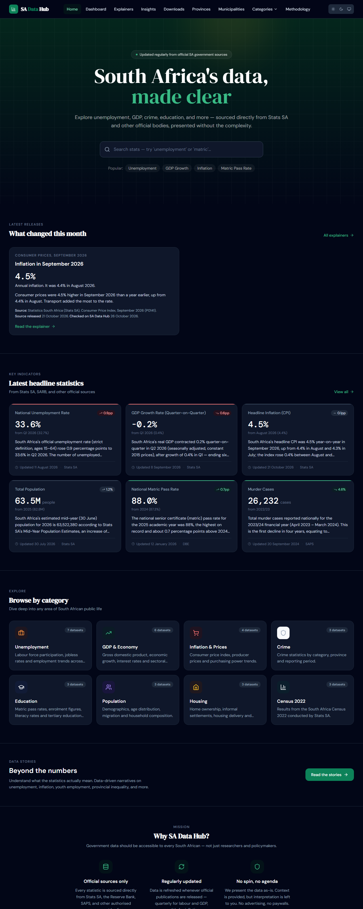 |  |
| Homepage, phone | 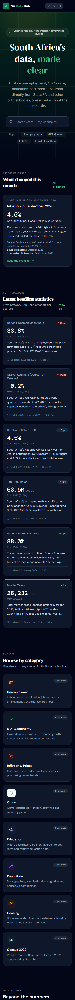 | 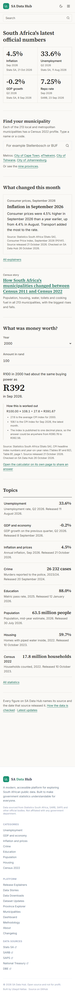 |
| Inflation topic, desktop | 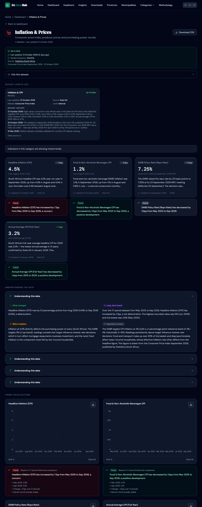 | 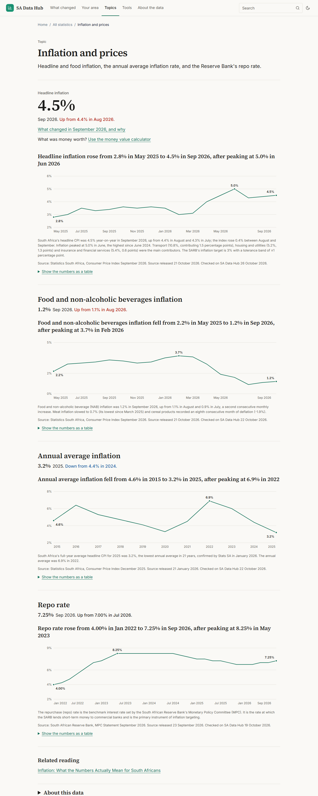 |
| Inflation topic, phone | 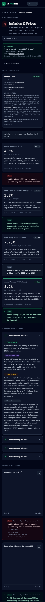 | 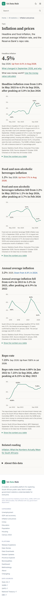 |
| City of Cape Town, desktop | 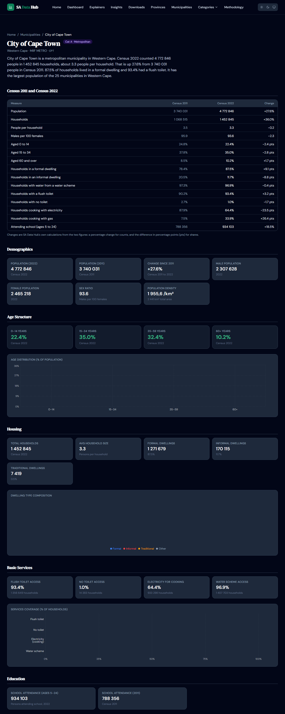 |  |
| City of Cape Town, phone | 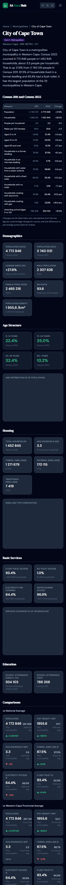 | 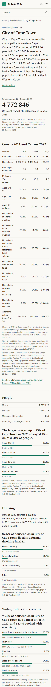 |
| CPI explainer, desktop | 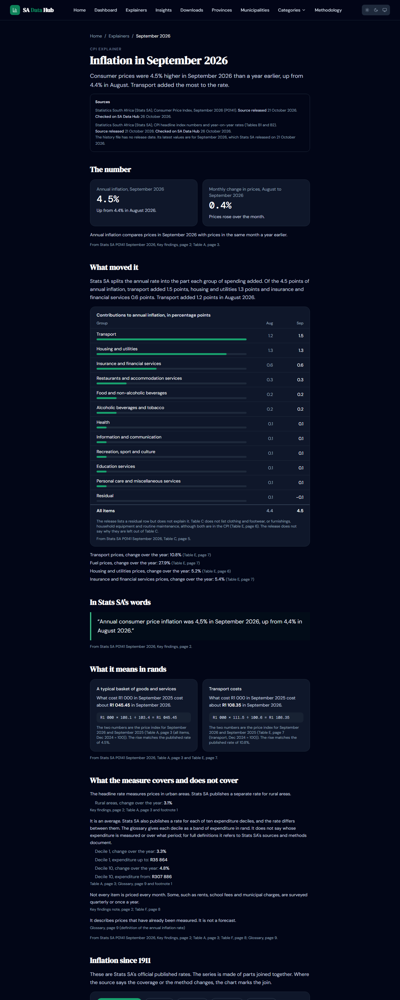 |  |
| CPI explainer, phone | 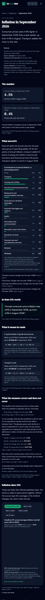 | 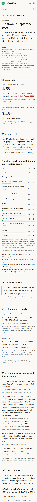 |

## What to measure next

Clicks and click-through from South Africa per page type, against the 23 October 2026 baseline above, and whether the number of indexed pages recovers.

TODO before publishing: add the Search Console figures for the period after these changes.
